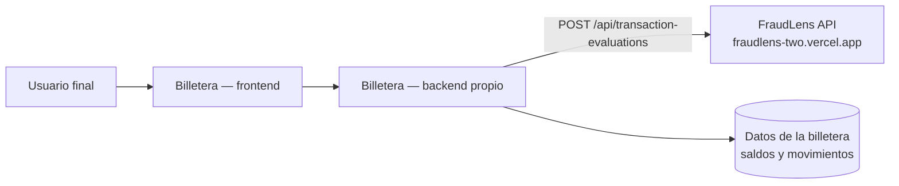
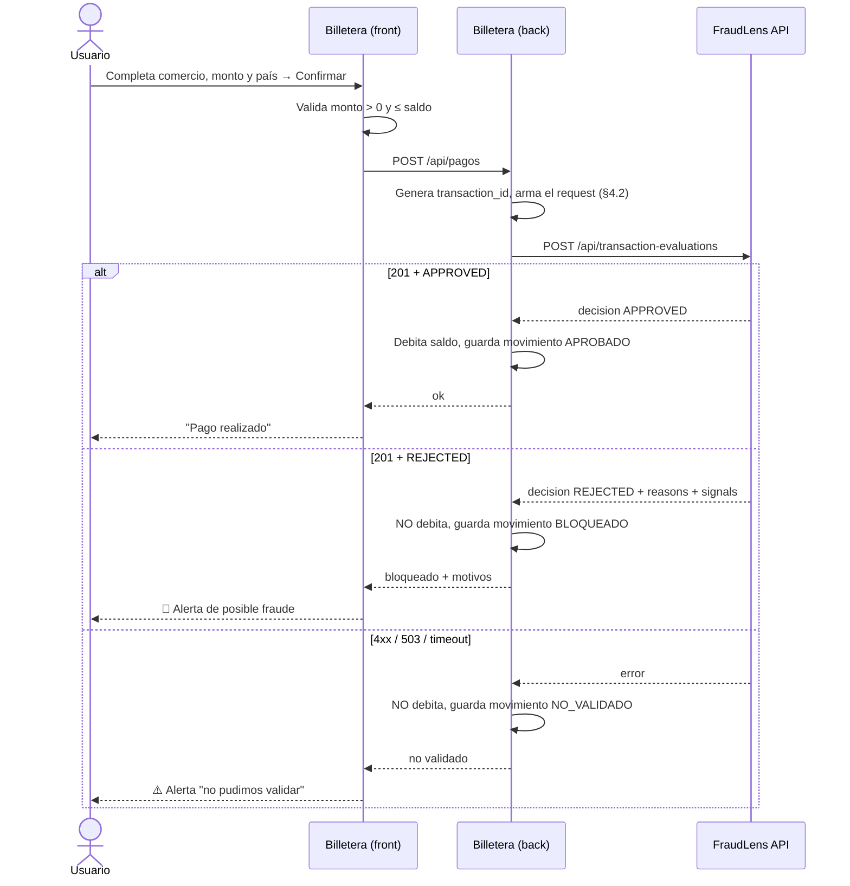

# Especificación — Billetera virtual de demostración que consume FraudLens

| | |
|---|---|
| **Estado** | 🟡 **Borrador — pendiente de revisión del equipo.** No es fuente de verdad hasta que se apruebe (regla 8) |
| **Fecha** | 2026-11-25 |
| **Pedido por** | FGR |
| **Redactado con** | Claude Code (Opus 5.5), a partir del README y `docs/architecture.md` del repo `fraudlens-MVP` (commit `78a2a6d`) |
| **Ticket** | [Armar la demo de integración de FraudLens para la presentación del MVP](https://trello.com/c/LqVQdkQu) |
| **Decisión asociada** | [Decisión 0008](../03-decisiones/0008-demos-billetera-y-tiendanube.md) — **FGR, 2026-11-25:** se construyen **las dos demos** (billetera y Tiendanube) para la presentación del MVP, con fecha límite **9/12**. No se hace análisis de 6 Sombreros porque no hay alternativas entre las que elegir. La spec sigue en borrador hasta que la revise el equipo |
| **Fecha límite** | **9/12/2026** (Final regular) |

> **Qué es esto.** Una app chica de billetera virtual cuyo único propósito es **mostrar a FraudLens
> integrado en el flujo de una fintech**: el usuario paga, la billetera le pregunta a FraudLens si
> la operación es riesgosa, y si lo es, frena el pago y muestra una alerta.
>
> **Qué NO es.** No es un producto de FraudLens ni parte del MVP: es un **cliente de demostración**
> que hace el papel del sistema de la fintech (Perfil B, [decisión 0004](../03-decisiones/0004-enfoque-cliente-fintech-bancos.md))
> frente al usuario final (Perfil C, [usuarios.md](usuarios.md)). Antes de construirla, contrastala
> con la lista "NO MVP" y con el [MoSCoW](alcance-mvp-moscow.md).

### Convención de fuentes de este documento

| Marca | Significa |
|---|---|
| 📘 **API** | Dato tomado de la documentación del repo `fraudlens-MVP` (README / `architecture.md`). Es comportamiento real del sistema |
| 💡 **Sugerencia** | Propuesta de Claude. **No es decisión del equipo** — hay que aprobarla o cambiarla |
| ⬜ **A definir** | Hueco explícito. No se completa hasta que el equipo lo decida |

---

## 1. Objetivo

Construir una billetera virtual con **funcionalidades mínimas** que, antes de confirmar cada pago,
**consulte la API de FraudLens** (`POST /api/transaction-evaluations`) y:

- si FraudLens devuelve `APPROVED` → confirma el pago y debita el saldo;
- si devuelve `REJECTED` → **no** debita y muestra una **alerta de posible fraude** con los motivos;
- si FraudLens no responde o falla → **no** debita y muestra una alerta de "no se pudo validar".

## 2. Alcance

### 2.1 Dentro del alcance (funcionalidades mínimas)

| ID | Funcionalidad | Por qué es mínima |
|---|---|---|
| BV-01 | Elegir un usuario de demostración (sin login real) | Hace falta un `user_id` estable para que FraudLens use el historial del usuario |
| BV-02 | Ver saldo disponible | Muestra el efecto de aprobar / rechazar |
| BV-03 | **Pagar a un comercio** (validado por FraudLens) | Es el flujo que se quiere demostrar |
| BV-04 | **Alerta** cuando FraudLens rechaza o no puede evaluar | Es el otro flujo que se quiere demostrar |
| BV-05 | Ver la lista de movimientos con su resultado (aprobado / bloqueado / no validado) | Deja rastro de lo que pasó en la demo |

### 2.2 Fuera del alcance

| Funcionalidad | Motivo |
|---|---|
| **Transferencias entre personas (P2P), cobros, recargas, retiros** | 📘 **API:** FraudLens hoy **sólo admite `operation_type: "PURCHASE"`**. Cualquier otro tipo devuelve `400`. Se suma cuando la API lo soporte |
| Registro, login real, KYC, recuperación de clave | No aporta a demostrar la integración |
| Dinero real, pasarelas de pago, tarjetas reales | Es una demo; los saldos son ficticios |
| Revisión manual del caso / "fue un error, aprobalo igual" | Eso es trabajo del analista (Perfil A) en FraudLens, no del usuario final |
| Notificaciones push / email / SMS | La alerta en pantalla alcanza para la demo |
| Multi-moneda con conversión | 📘 **API:** FraudLens compara montos sólo en la misma moneda, sin conversión |
| App mobile nativa | 💡 **Sugerencia:** web responsive alcanza |

## 3. Arquitectura



**Regla de integración:** 💡 **Sugerencia** — **el navegador nunca llama directo a FraudLens.** La
llamada la hace el backend de la billetera, por tres motivos:

1. 📘 **API:** el despliegue de FraudLens está detrás de la **protección de Vercel**, y el README
   pide explícitamente no deshabilitarla. Un acceso automatizado necesita una credencial de bypass
   que **no puede** quedar expuesta en el navegador (ver [§10, Q-01](#10-preguntas-abiertas)).
2. La API no documenta CORS para orígenes externos.
3. **Es lo que haría una fintech real:** la decisión de debitar o no la toma el servidor, no el
   cliente. Si la validación estuviera en el navegador, se podría saltear.

**Stack:** ⬜ **A definir.** 💡 **Sugerencia:** Next.js (App Router + Route Handlers), igual que el
MVP, para que el equipo no aprenda otra cosa. Persistencia: un archivo JSON o SQLite alcanza para
la demo; no hace falta MongoDB.

## 4. Contrato con la API de FraudLens

### 4.1 Endpoint

📘 **API:** `POST {FRAUDLENS_BASE_URL}/api/transaction-evaluations` con
`Content-Type: application/json`.

| Entorno | `FRAUDLENS_BASE_URL` |
|---|---|
| Local | `http://localhost:3000` |
| Producción | `https://fraudlens-two.vercel.app` |

### 4.2 Request — cómo se arma desde la billetera

📘 **API:** los **once campos son obligatorios**; los campos de más se ignoran.

| Campo FraudLens | Regla de la API 📘 | De dónde sale en la billetera |
|---|---|---|
| `transaction_id` | String no vacío | 💡 UUID generado por la billetera al iniciar el pago. Se guarda en el movimiento |
| `user_id` | String no vacío | ID del usuario de demostración (BV-01). **Tiene que ser siempre el mismo para el mismo usuario** |
| `transaction_datetime` | ISO 8601 **con zona horaria** | Fecha/hora del pago, ej. `2026-11-25T18:45:00-03:00` |
| `amount` | Número positivo | Monto que ingresó el usuario |
| `currency` | 3 letras mayúsculas | ⬜ **A definir.** 💡 `ARS` fijo |
| `operation_type` | **Sólo `PURCHASE`** | Fijo: `PURCHASE` |
| `merchant` | String no vacío | Comercio elegido o escrito por el usuario |
| `country` | 2 letras | País donde se hace la compra. ⬜ **A definir** cómo se obtiene (ver nota) |
| `card_country` | 2 letras — país de **emisión de la tarjeta** | País del medio de pago asociado al usuario. ⬜ **A definir** (ver nota) |
| `cardholder_present` | Booleano | 💡 `false` (pago online desde la billetera) |
| `card_present` | Booleano | 💡 `false` (pago online desde la billetera) |

> ⚠️ **Nota sobre `country` y `card_country`.** La API está pensada para pagos con tarjeta. Una
> billetera que paga con saldo en cuenta **no tiene una tarjeta** de forma natural, y estos dos
> campos son justamente los que usa FraudLens para detectar `COUNTRY_MISMATCH`. Hay que decidir
> cómo se modelan (ver [§10, Q-02](#10-preguntas-abiertas)). 💡 **Sugerencia para la demo:** cada
> usuario de demostración tiene una "tarjeta vinculada" con un país fijo (`card_country`), y en la
> pantalla de pago hay un selector de "país del comercio" (`country`) para poder provocar el caso
> de país distinto en vivo.

Ejemplo:

```json
{
  "transaction_id": "b7e1c2a4-5f3d-4c1e-9a0b-2d6f8e1a3c55",
  "user_id": "demo-user-01",
  "transaction_datetime": "2026-11-25T18:45:00-03:00",
  "amount": 25000,
  "currency": "ARS",
  "operation_type": "PURCHASE",
  "merchant": "Supermercado Ejemplo",
  "country": "AR",
  "card_country": "AR",
  "cardholder_present": false,
  "card_present": false
}
```

### 4.3 Respuesta exitosa (`201 Created`)

📘 **API:**

```json
{
  "transaction_evaluation_id": "<ObjectId>",
  "transaction_id": "b7e1c2a4-...",
  "risk_score": 0.1,
  "decision": "APPROVED",
  "reasons": ["Monto y comercio consistentes con el historial disponible."],
  "signals": [],
  "rules_applied": [],
  "model_id": "openai/gpt-oss-20b",
  "assessment_version": "transaction-risk-v1",
  "history_count": 3
}
```

Qué usa la billetera de cada campo:

| Campo | Uso en la billetera |
|---|---|
| `decision` | **Única fuente de la decisión**: `APPROVED` o `REJECTED`. La billetera no reinterpreta nada |
| `reasons` | Texto de la alerta (lista de motivos) |
| `signals` | Etiquetas de la alerta (ver §6.3) |
| `transaction_evaluation_id` | Se guarda en el movimiento para trazabilidad con FraudLens |
| `risk_score` | ⚠️ **No se muestra como porcentaje ni como probabilidad.** 📘 **API:** es una estimación del modelo, **no una probabilidad calibrada**. 💡 No mostrarlo al usuario final |
| `history_count` | 💡 Sólo en modo demo/presentador, para explicar por qué FraudLens marcó `INSUFFICIENT_HISTORY` |
| `model_id`, `assessment_version`, `rules_applied` | Se guardan; no se muestran |

### 4.4 Errores

📘 **API:**

| Código | Cuándo | Qué hace la billetera |
|---|---|---|
| `400` | JSON o campos inválidos | **Bug de la billetera**, no del usuario. No debita. Alerta "No pudimos procesar el pago". Se loguea el error |
| `415` | Content-Type distinto de JSON | Ídem `400` |
| `503` | Falla de historial, inferencia, validación o persistencia en FraudLens. Mensaje: `Unable to evaluate transaction` | No debita. Alerta "No pudimos validar el pago" (§6.4) |
| Timeout / red / 401-403 de Vercel | FraudLens no responde o la protección bloquea | Igual que `503` |

### 4.5 Restricciones de la API que condicionan el diseño

| Restricción 📘 **API** | Consecuencia para la billetera |
|---|---|
| La inferencia tiene **timeout de 30 s** y **sin reintentos** | 💡 La billetera espera hasta **35 s** y muestra un estado "Validando pago…" bloqueante. No se puede asumir respuesta instantánea |
| **No hay idempotencia:** cada POST crea una evaluación nueva, aunque se repita el `transaction_id` | **La billetera no reintenta automáticamente.** Un reintento duplicaría evaluaciones y contaminaría el historial. Si el usuario reintenta, es un pago nuevo con `transaction_id` nuevo |
| **No hay autenticación propia** de la app, sólo la protección de Vercel | Ver Q-01 |
| El historial que usa FraudLens son hasta **50 transacciones `APPROVED`** previas del mismo `user_id` | Los rechazos no cuentan como historial. Un usuario nuevo arranca sin historial y FraudLens decide igual, informando `INSUFFICIENT_HISTORY` |
| La decisión la toma el modelo (Groq), **sin umbrales ni reglas** | El mismo pago puede no dar siempre el mismo resultado. **La demo no puede prometer un resultado fijo** (ver §8) |

## 5. Modelo de datos de la billetera

💡 **Sugerencia** — mínimo indispensable.

**Usuario de demostración**

| Campo | Tipo | Nota |
|---|---|---|
| `id` | string | Se manda como `user_id` a FraudLens |
| `nombre` | string | Sólo para mostrar |
| `saldo` | número | En `ARS`. ⬜ Saldo inicial a definir |
| `pais_medio_pago` | string (2 letras) | Se manda como `card_country` |

**Movimiento**

| Campo | Tipo | Nota |
|---|---|---|
| `id` | string | Igual al `transaction_id` enviado a FraudLens |
| `usuario_id` | string | |
| `fecha` | ISO 8601 | |
| `comercio` | string | |
| `monto` | número | |
| `pais` | string (2 letras) | |
| `estado` | `APROBADO` · `BLOQUEADO` · `NO_VALIDADO` | `BLOQUEADO` = FraudLens devolvió `REJECTED`; `NO_VALIDADO` = error / timeout |
| `evaluacion_id` | string \| null | `transaction_evaluation_id`; `null` si no hubo respuesta |
| `motivos` | string[] | `reasons` de FraudLens |
| `senales` | string[] | `signals` de FraudLens |

**Regla de saldo:** sólo los movimientos `APROBADO` descuentan saldo.

## 6. Flujos y pantallas

### 6.1 Pantallas

| Pantalla | Contenido |
|---|---|
| **P1 · Elegir usuario** | Lista de usuarios de demostración (nombre + país del medio de pago) |
| **P2 · Inicio** | Saldo, botón "Pagar", últimos movimientos con su estado |
| **P3 · Pagar** | Comercio, monto, país del comercio, botón "Confirmar pago". Valida que el monto sea > 0 y ≤ saldo **antes** de llamar a FraudLens |
| **P4 · Validando** | Estado de espera bloqueante ("Estamos verificando la seguridad del pago…"). No permite volver a enviar |
| **P5 · Resultado** | Éxito, **alerta de fraude** (§6.3) o **alerta de no validado** (§6.4) |
| **P6 · Movimientos** | Lista completa; tocar un movimiento muestra los motivos que devolvió FraudLens |

⬜ **A definir:** diseño visual. 💡 Reusar la [identidad visual](identidad-visual.md) sólo si el
equipo quiere que se note que es "powered by FraudLens"; si no, conviene que la billetera tenga una
marca propia neutra para que se entienda que es *un cliente* de FraudLens.

### 6.2 Flujo principal — pagar



> **Política ante falla de FraudLens:** 💡 **Sugerencia — "fail-closed"**: si no hay respuesta, el
> pago **no** se hace. Es lo coherente con una demo de antifraude, pero en una fintech real es una
> decisión de negocio (rechazar de más también le duele al Perfil C). ⬜ **A confirmar por el
> equipo** (Q-03).

### 6.3 Alerta de posible fraude (`REJECTED`)

Contenido mínimo:

- **Título:** "Frenamos este pago por seguridad"
- **Detalle del pago:** comercio, monto, país.
- **Motivos:** la lista `reasons` tal como la devuelve FraudLens.
- **Etiquetas** a partir de `signals` 📘 (los cuatro valores posibles según la API):

| `signal` | Texto sugerido 💡 |
|---|---|
| `UNUSUAL_AMOUNT` | Monto fuera de lo habitual |
| `UNUSUAL_MERCHANT` | Comercio poco habitual para vos |
| `COUNTRY_MISMATCH` | El país del pago no coincide con el de tu medio de pago |
| `INSUFFICIENT_HISTORY` | Todavía tenemos poca información de tus pagos |
| *(cualquier otro valor)* | Se muestra el valor tal cual — la billetera no debe romperse si la API suma señales |

- **Aclaración:** "No se descontó dinero de tu cuenta."
- **Acciones:** "Entendido" (vuelve al inicio). ⬜ ¿Hace falta un "No fui yo / Contactar soporte"?
  Para la demo sería un botón sin acción real.

> ⚠️ Los textos de `reasons` los genera el modelo. **No se editan ni se resumen en la billetera**,
> para que la demo muestre lo que FraudLens realmente devolvió.

### 6.4 Alerta de no validado (error / timeout)

- **Título:** "No pudimos validar el pago"
- **Texto:** "Por seguridad no realizamos el pago. Probá de nuevo en unos minutos."
- **Aclaración:** "No se descontó dinero de tu cuenta."
- **No** se muestra el detalle técnico del error al usuario. Se loguea en el servidor de la billetera
  (sin datos sensibles).

## 7. Requisitos no funcionales

| ID | Requisito | Fuente |
|---|---|---|
| RNF-01 | La URL de FraudLens y cualquier credencial (bypass de Vercel) van en variables de entorno del **servidor**, nunca con prefijo público ni en el repo | 💡 + 📘 (el MVP sigue la misma regla) |
| RNF-02 | Timeout de la llamada a FraudLens: 35 s | 💡, derivado del timeout de 30 s 📘 |
| RNF-03 | Sin reintentos automáticos a FraudLens | 📘 (no hay idempotencia) |
| RNF-04 | Ningún pago se debita sin una respuesta `APPROVED` | 💡 (política fail-closed, a confirmar) |
| RNF-05 | Usar sólo datos ficticios. Nada de nombres, tarjetas o datos reales | 📘 (el README pide no enviar datos sensibles a Groq) |
| RNF-06 | Funciona en pantalla de celular (≥ 360 px de ancho) | 💡 |

## 8. Guion de demostración

💡 **Sugerencia** para la presentación. Todos los valores ⬜ **a calibrar probando contra la API real**.

1. **Armar historial:** con `demo-user-01` (medio de pago `AR`) hacer 3–5 pagos chicos en comercios
   de siempre, país `AR` → se esperan `APPROVED`.
2. **Caso normal:** otro pago parecido → `APPROVED`, se descuenta el saldo.
3. **Caso sospechoso:** pago por un monto muy superior al habitual, en un comercio nuevo, con país
   del comercio distinto (`US`) → se espera `REJECTED` con `UNUSUAL_AMOUNT`, `UNUSUAL_MERCHANT`,
   `COUNTRY_MISMATCH` → **alerta**.
4. Mostrar en **Movimientos** que el pago bloqueado quedó registrado y el saldo no cambió.

> ⚠️ **El resultado no está garantizado.** 📘 **API:** la decisión la toma un modelo de lenguaje
> sin umbrales fijos; el mismo caso puede dar otro resultado, y una salida válida "no demuestra
> calidad predictiva". **Ensayar antes** y tener plan B (capturas o video) por si FraudLens aprueba
> el caso sospechoso, tarda más de lo esperado o se queda sin cuota de Groq.
>
> ⚠️ Cada POST se persiste en la base de FraudLens. Hacer la demo contra **producción** mete estas
> evaluaciones en el historial real del MVP (Q-04).

## 9. Criterios de aceptación

| ID | Dado / Cuando / Entonces |
|---|---|
| CA-01 | **Dado** un usuario con saldo suficiente, **cuando** confirma un pago y FraudLens devuelve `APPROVED`, **entonces** se descuenta el monto, el movimiento queda `APROBADO` y se ve "Pago realizado" |
| CA-02 | **Dado** un pago, **cuando** FraudLens devuelve `REJECTED`, **entonces** el saldo no cambia, el movimiento queda `BLOQUEADO` y se muestra la alerta con todos los `reasons` y las etiquetas de `signals` |
| CA-03 | **Dado** un pago, **cuando** FraudLens devuelve `503` o no responde en 35 s, **entonces** el saldo no cambia, el movimiento queda `NO_VALIDADO` y se muestra la alerta de no validado |
| CA-04 | **Dado** un monto ≤ 0 o mayor al saldo, **cuando** el usuario confirma, **entonces** la billetera lo rechaza **sin** llamar a FraudLens |
| CA-05 | **Dado** un pago en curso, **cuando** el usuario vuelve a tocar "Confirmar", **entonces** no se envía un segundo request |
| CA-06 | **Dado** cualquier pago enviado, **entonces** el request a FraudLens tiene los once campos con el formato de §4.2 y `operation_type: "PURCHASE"` |
| CA-07 | **Dado** el frontend de la billetera, **entonces** no hay ninguna llamada directa del navegador a FraudLens ni credenciales en el bundle público |
| CA-08 | **Dado** que FraudLens devuelve un `signal` desconocido, **entonces** la alerta lo muestra tal cual y no rompe la pantalla |

💡 Para probar CA-02/CA-03 sin depender del modelo ni gastar cuota de Groq: un **mock** del
endpoint de FraudLens en los tests de la billetera que devuelva `APPROVED`, `REJECTED` y `503` a
pedido. La [colección de Postman](../../../fraudlens-MVP/postman/FraudLens.postman_collection.json)
del MVP sirve de referencia para los formatos *(ruta relativa válida sólo si ambos repos están
clonados lado a lado)*.

## 10. Preguntas abiertas

> Se cargan en [`preguntas-abiertas.md`](../00-proyecto/preguntas-abiertas.md) con ID definitivo
> cuando el equipo apruebe avanzar con la billetera.

| ID | Pregunta | Para quién | Bloquea |
|---|---|---|---|
| Q-01 | ¿Cómo accede un sistema externo a FraudLens en producción si la **protección de Vercel** está activa? ¿Se habilita un token de bypass para automatización, o la billetera se despliega/usa sólo contra FraudLens local? | Quien administre el proyecto en Vercel | Integración en producción |
| Q-02 | ¿Cómo se modelan `country` y `card_country` en una billetera que paga con saldo y no con tarjeta? | Equipo | §4.2 |
| Q-03 | Si FraudLens no responde: ¿el pago se bloquea (fail-closed) o se deja pasar (fail-open)? | Equipo | §6.2 |
| Q-04 | ¿La demo corre contra la base de producción de FraudLens o contra una base aparte? | Equipo | §8 |
| Q-05 | ¿Esta billetera entra al alcance de la materia (se presenta / se evalúa) o es sólo una herramienta interna de demostración? Contrastar con "NO MVP" y MoSCoW | Equipo (y eventualmente el docente) | Si se construye |
| Q-06 | ¿Dónde vive el código: repo nuevo, carpeta dentro de `fraudlens-MVP` o en el `FraudLens-prototipo`? | Equipo | Arranque |
| Q-07 | Stack, moneda, saldo inicial y cantidad de usuarios de demostración | Equipo | Implementación |
