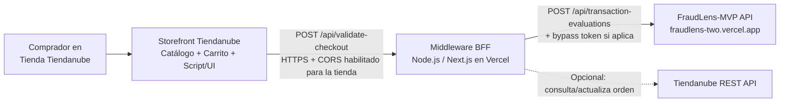
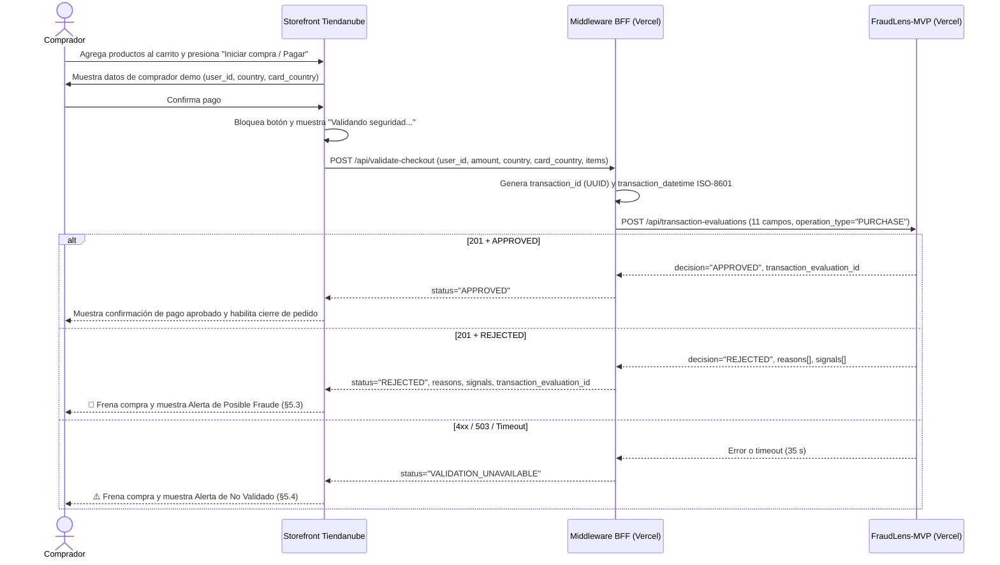

# Especificación — E-commerce de demostración en Tiendanube integrado con FraudLens-MVP

| | |
|---|---|
| **Estado** | 🟡 **Borrador — pendiente de revisión del equipo.** No es fuente de verdad hasta que se apruebe (regla 8) |
| **Fecha** | 2026-11-25 |
| **Pedido por** | FGR |
| **Objetivo** | Demostrar la integración de un e-commerce real alojado en Tiendanube consumiendo la API de `fraudlens-MVP` desplegada en Vercel |
| **Ticket** | [Armar la demo de integración de FraudLens para la presentación del MVP](https://trello.com/c/LqVQdkQu) |
| **Decisión asociada** | [Decisión 0008](../03-decisiones/0008-demos-billetera-y-tiendanube.md) — **FGR, 2026-11-25:** se construyen **las dos demos** (billetera y Tiendanube) para la presentación del MVP, con fecha límite **9/12**. No se hace análisis de 6 Sombreros porque no hay alternativas entre las que elegir. La spec sigue en borrador hasta que la revise el equipo |
| **Fecha límite** | **9/12/2026** (Final regular) |

> **Qué es esto.** La especificación de una tienda online mínima alojada en **Tiendanube** cuyo
> propósito es **demostrar en vivo la integración con la API de FraudLens-MVP** (`fraudlens-two.vercel.app`):
> un comprador selecciona productos, inicia el pago, la tienda consulta a FraudLens antes de confirmar
> la operación y, si FraudLens detecta riesgo (`REJECTED`) o no puede validar (`503`/timeout), la
> tienda frena la compra y presenta una **alerta clara en pantalla**.
>
> **Qué NO es.** No forma parte del código núcleo del MVP de FraudLens ni cambia el segmento objetivo
> del proyecto (fintechs, billeteras y bancos según la [decisión 0004](../03-decisiones/0004-enfoque-cliente-fintech-bancos.md)).
> Es un **sistema cliente de demostración** pensado para probar el endpoint productivo de FraudLens
> desde una plataforma de e-commerce real.

### Convención de fuentes de este documento

| Marca | Significa |
|---|---|
| 📘 **API** | Comportamiento documentado de `fraudlens-MVP` en [`mvp.md`](mvp.md) y [`spec-billetera-demo.md`](spec-billetera-demo.md) |
| 💡 **Sugerencia** | Propuesta de diseño e integración. **No es decisión del equipo** — requiere validación |
| ⬜ **A definir** | Hueco explícito que el equipo debe confirmar antes o durante la implementación |

---

## 1. Objetivo

Construir una tienda e-commerce mínima alojada en **Tiendanube** que permita vender productos de
demostración y que, al momento de validar una transacción de compra, **consuma la API de FraudLens-MVP
en Vercel** (`POST /api/transaction-evaluations`) a través de un middleware seguro para:

- si FraudLens devuelve `APPROVED` → confirmar el flujo de compra y mostrar comprobante de operación aprobada;
- si FraudLens devuelve `REJECTED` → **frenar la confirmación de la compra** y mostrar una **alerta de posible fraude** con los motivos (`reasons`) y señales (`signals`) devueltos por la API;
- si FraudLens no responde, devuelve error (`503` / `4xx`) o vence el timeout → **frenar la compra** (política *fail-closed* sugerida) y presentar una **alerta de validación no disponible**.

---

## 2. Alcance

### 2.1 Dentro del alcance (funcionalidades mínimas del e-commerce)

| ID | Funcionalidad | Por qué es mínima |
|---|---|---|
| TN-01 | **Catálogo básico de productos** (4 a 6 productos ficticios) | Permite simular compras con montos variados (chicos para historial normal y altos para disparar anomalías) |
| TN-02 | **Ficha de producto y carrito de compras** | Funcionalidades nativas mínimas de Tiendanube para armar un pedido (`amount` calculado) |
| TN-03 | **Identificación de comprador y medio de pago demo** | Permite enviar un `user_id` consistente (para historial) y un país de tarjeta (`card_country`) sin requerir tarjeta real |
| TN-04 | **Validación de transacción contra FraudLens-MVP** | Consume `POST /api/transaction-evaluations` vía Middleware BFF antes de dar la compra por aprobada |
| TN-05 | **Alerta visual ante problema (`REJECTED` o falla)** | Muestra al comprador un bloqueo claro con motivos/señales o aviso de error sin completar el cobro |
| TN-06 | **Registro visible en el dashboard de FraudLens** | Cada intento enviado queda persistido en `fraudlens-two.vercel.app` para mostrar el cruce tienda ↔ panel antifraude |

### 2.2 Fuera del alcance

| Funcionalidad | Motivo |
|---|---|
| Cobros reales con pasarelas productivas (Mercado Pago real, tarjetas reales) | 📘 **API:** no deben enviarse datos reales ni información sensible de tarjetas/personas al LLM |
| Registro complejo de usuarios / login obligatorio con KYC | Para la demo basta un selector o campo de comprador de prueba con `user_id` estable |
| Gestión logística real (envíos por correo, facturación AFIP, stock complejo) | No aporta al objetivo de demostrar la integración antifraude |
| Múltiples monedas con conversión automática | 📘 **API:** FraudLens compara montos en la misma moneda sin conversión; se fija `ARS` |
| Panel propio de analista dentro de Tiendanube | La revisión de transacciones y motivos históricos ya vive en el dashboard de `fraudlens-MVP` |
| Reversión automática de contracargos o apelación desde la tienda | Fuera del alcance del MVP de FraudLens ([`requerimientos-funcionales-mvp.md`](requerimientos-funcionales-mvp.md)) |

---

## 3. Arquitectura de integración

### 3.1 Por qué no se llama a Vercel directo desde el navegador en Tiendanube

💡 **Sugerencia obligatoria de arquitectura:** el JavaScript alojado en el storefront de Tiendanube **no
debe llamar directamente** a `https://fraudlens-two.vercel.app/api/transaction-evaluations`, por tres
motivos técnicos verificados:

1. **Protección de despliegue en Vercel:** 📘 **API:** el despliegue de `fraudlens-MVP` en Vercel
   cuenta con protección de acceso. Si se requiere un token de bypass (`x-vercel-protection-bypass`),
   colocarlo en un script público del storefront de Tiendanube lo dejaría expuesto en el navegador de
   cualquier visitante.
2. **CORS (Cross-Origin Resource Sharing):** 📘 **API:** `fraudlens-MVP` no documenta encabezados
   CORS abiertos para dominios externos (`*.mitiendanube.com`). Una llamada directa desde el navegador
   sería bloqueada por política de mismo origen.
3. **Integridad de la decisión:** si la validación corriera exclusivamente en el cliente sin pasar por
   un servidor propio, un usuario técnico podría omitir el script desde DevTools.

Por eso se interpone un **Middleware BFF (Backend-for-Frontend)** liviano (por ejemplo, una función
serverless en Vercel o un servicio Node.js) entre la tienda en Tiendanube y `fraudlens-two.vercel.app`.



### 3.2 Opciones de punto de integración dentro de Tiendanube

En Tiendanube el checkout nativo está gestionado por la plataforma. Existen **tres mecanismos**
posibles para conectar el flujo de compra con el Middleware BFF; se recomienda la **Opción A** para la
demostración:

| Opción | Cómo funciona | Ventajas para la demo | Limitaciones / requisitos |
|---|---|---|---|
| **A. Script en Storefront / Carrito pre-checkout** *(💡 Recomendada)* | Un script JS cargado en Tiendanube (vía **Códigos externos** o edición de plantilla/FTP del tema) intercepta el paso previo al pago en el carrito/drawer, abre un paso de datos de pago demo (país de tarjeta + ID comprador), llama al BFF y solo deja avanzar si FraudLens devuelve `APPROVED`. | Se implementa rápido sin esperar aprobación comercial de Tiendanube Partners; muestra la **alerta en tiempo real** al comprador antes de concretar la compra. | El bloqueo ocurre antes de entrar al checkout nativo cerrado de Tiendanube (salvo que la tienda use una App de Pago). |
| **B. App de Proveedor de Pagos (Payment Provider App)** | App registrada en Tiendanube Partners que aparece como medio de pago dentro del checkout nativo. Al confirmar el pago, Tiendanube invoca al backend de la app y este consulta a FraudLens. | Integración 100 % nativa dentro del checkout estándar de Tiendanube. | Requiere cuenta en Tiendanube Partners, creación/configuración de App de Pagos y homologación/sandbox de Tiendanube. ⬜ A verificar permisos. |
| **C. Webhook `order/created` + API de Órdenes** | El comprador termina el checkout en Tiendanube; Tiendanube dispara el webhook `order/created` al BFF; el BFF llama a FraudLens y, si da `REJECTED`, cancela la orden (`POST /orders/{id}/cancel`) y registra nota. | No modifica el storefront ni requiere crear un Payment Provider. | **Es asíncrono:** el comprador ya vio "compra realizada" antes de que FraudLens responda; mostrarle la alerta en pantalla exige polling en la página de estado del pedido. |

> 💡 **Criterio práctico:** usar **Opción A** si el objetivo es demostrar en vivo el bloqueo preventivo
> con alerta inmediata en una tienda alojada en Tiendanube en poco tiempo. Si el equipo ya tiene
> acceso a un entorno de Tiendanube Partners con Payment Provider habilitado, la **Opción B** es el
> equivalente productivo.

---

## 4. Contrato con la API de FraudLens-MVP

### 4.1 Endpoints disponibles

📘 **API:**

| Propósito | Método y ruta | Uso desde el e-commerce |
|---|---|---|
| Evaluar transacción | `POST {FRAUDLENS_BASE_URL}/api/transaction-evaluations` | Llamado por el BFF al confirmar compra (`Content-Type: application/json`) |
| Verificar salud | `GET {FRAUDLENS_BASE_URL}/api/health` | Chequeo previo a la demo (`{"status":"ok","service":"fraudlens"}`) |
| Consultar historial | `GET {FRAUDLENS_BASE_URL}/api/transaction-evaluations?limit=20&offset=0` | Sólo para verificación en el dashboard de FraudLens, no lo consume la tienda |

| Entorno | `FRAUDLENS_BASE_URL` |
|---|---|
| Producción (objetivo de la demo) | `https://fraudlens-two.vercel.app` |
| Local (desarrollo del BFF) | `http://localhost:3000` |

### 4.2 Request — mapeo desde Tiendanube hacia FraudLens

📘 **API:** los **once (11) campos son obligatorios**; cualquier campo extra que envíe el BFF es ignorado
por el endpoint, y la falta o formato inválido de cualquiera devuelve `400 Bad Request`.

| Campo FraudLens | Regla de la API 📘 | Origen en el e-commerce (Tiendanube → BFF) |
|---|---|---|
| `transaction_id` | String no vacío | 💡 UUID v4 generado por el BFF al iniciar el intento de pago (o `tn-order-{id}` si viene de orden creada). |
| `user_id` | String no vacío | Identificador estable del comprador de prueba (ej. `tn-buyer-01` o email normalizado en demo). **Debe mantenerse constante entre compras del mismo comprador** para que FraudLens use su historial. |
| `transaction_datetime` | ISO 8601 **con zona horaria** | Timestamp generado por el BFF al momento de validar, ej. `2026-11-25T19:30:00-03:00`. |
| `amount` | Número positivo (`> 0`) | Total del carrito / orden en Tiendanube (productos + envío si aplica). |
| `currency` | 3 letras mayúsculas | 💡 `"ARS"` fijo para la demo (o tomado de la moneda de la tienda en Tiendanube si está en `ARS`). |
| `operation_type` | **Sólo `"PURCHASE"`** | Fijo `"PURCHASE"`. Cualquier otro valor devuelve `400`. |
| `merchant` | String no vacío | Nombre de la tienda en Tiendanube (ej. `"Tienda Demo FraudLens"` o `"Tienda Demo - Electrónica"`). 💡 Puede incluir categoría para enriquecer contexto si se mantiene consistente. |
| `country` | 2 letras (ISO 3166-1 alpha-2) | País de compra/envío seleccionado en el checkout de Tiendanube (ej. `"AR"`, o seleccionable en demo para probar anomalías). |
| `card_country` | 2 letras — país de **emisión de la tarjeta** | País emisor de la tarjeta ficticia del comprador (ej. `"AR"`, editable en selector demo para provocar `COUNTRY_MISMATCH`). |
| `cardholder_present` | Booleano | Fijo `false` (compra e-commerce online / tarjeta no presente). |
| `card_present` | Booleano | Fijo `false` (compra e-commerce online / tarjeta no presente). |

Ejemplo de payload enviado por el BFF a `https://fraudlens-two.vercel.app/api/transaction-evaluations`:

```json
{
  "transaction_id": "tn-demo-9f3a12c4-8b2e-4d1a-9c5f-1a2b3c4d5e6f",
  "user_id": "tn-comprador-01",
  "transaction_datetime": "2026-11-25T19:30:00-03:00",
  "amount": 48500,
  "currency": "ARS",
  "operation_type": "PURCHASE",
  "merchant": "Tienda Demo FraudLens",
  "country": "AR",
  "card_country": "AR",
  "cardholder_present": false,
  "card_present": false
}
```

### 4.3 Respuesta exitosa (`201 Created`) y consumo en la tienda

📘 **API:**

```json
{
  "transaction_evaluation_id": "6744e1c2a9b1c2d3e4f50001",
  "transaction_id": "tn-demo-9f3a12c4-8b2e-4d1a-9c5f-1a2b3c4d5e6f",
  "risk_score": 0.88,
  "decision": "REJECTED",
  "reasons": [
    "El monto supera ampliamente el promedio habitual del usuario.",
    "El país de la operación no coincide con el país de emisión de la tarjeta."
  ],
  "signals": [
    "UNUSUAL_AMOUNT",
    "COUNTRY_MISMATCH"
  ],
  "rules_applied": [],
  "model_id": "openai/gpt-oss-20b",
  "assessment_version": "transaction-risk-v1",
  "history_count": 4
}
```

Cómo usa la tienda Tiendanube + BFF cada campo:

| Campo | Uso en el e-commerce |
|---|---|
| `decision` | **Única fuente de decisión:** `"APPROVED"` habilita la compra; `"REJECTED"` la frena y dispara la alerta de fraude. La tienda no aplica umbrales propios sobre `risk_score`. |
| `reasons` | Se muestran tal cual en el cuerpo de la alerta (sin editar ni truncar) para demostrar la explicabilidad de FraudLens. |
| `signals` | Se renderizan como etiquetas legibles en la alerta (ver mapeo en §5.3). |
| `transaction_evaluation_id` | Se muestra como "Código de verificación / referencia" en la alerta o comprobante para poder buscarlo en `fraudlens-two.vercel.app`. |
| `risk_score` | ⚠️ **No mostrar como porcentaje de probabilidad al comprador.** 📘 **API:** es una estimación del modelo, no una probabilidad calibrada. 💡 Opcionalmente oculto al comprador o mostrado sólo en un panel técnico de debug de la demo. |
| `history_count`, `model_id`, `assessment_version`, `rules_applied` | Se registran en logs del BFF (sin exponer detalles internos en la UI del comprador, salvo `history_count` si hay modo debug). |

### 4.4 Manejo de errores

📘 **API:**

| Código HTTP / Fallo | Causa | Comportamiento del BFF y de la tienda |
|---|---|---|
| `400 Bad Request` | Falta algún campo obligatorio o formato inválido (ej. fecha sin zona horaria, `operation_type != "PURCHASE"`) | El BFF loguea el error de integración y responde error controlado al storefront. **No confirma la compra.** |
| `415 Unsupported Media Type` | Falta header `Content-Type: application/json` | Ídem `400` (error interno del BFF). |
| `503 Service Unavailable` | Falla Groq, MongoDB o validación en FraudLens (`Unable to evaluate transaction`) | El BFF devuelve estado `VALIDATION_UNAVAILABLE`. La tienda muestra la **alerta de validación no disponible** (§5.4) y **no** confirma la compra. |
| `401` / `403` de Vercel | Protección de Vercel activa sin token de bypass válido | Ídem `503` (el usuario ve alerta de no validado; el BFF registra el código HTTP real en logs del servidor). |
| Timeout / falla de red | FraudLens demora más de 35 s o no responde | El BFF aborta la petición (`AbortController` a los 35 s) y devuelve `VALIDATION_UNAVAILABLE`. |

### 4.5 Restricciones técnicas que condicionan el diseño

| Restricción 📘 **API** | Impacto en el e-commerce |
|---|---|
| **Timeout de inferencia de 30 s sin reintentos** | 💡 El BFF debe configurar un timeout de **35 s** y el storefront debe mostrar un overlay bloqueante *"Validando seguridad de la compra…"* deshabilitando el botón de pago. |
| **Sin idempotencia en `POST`** | Cada llamada crea una evaluación nueva aunque se repita `transaction_id`. **Ni el storefront ni el BFF deben reintentar automáticamente.** Si el comprador reintenta luego de una falla, se genera un nuevo `transaction_id`. |
| **Historial basado en hasta 50 transacciones `APPROVED`** | Los rechazos (`REJECTED`) no se suman al historial positivo. Un comprador nuevo empieza con `history_count: 0` y señal `INSUFFICIENT_HISTORY`. |
| **Decisión tomada por LLM (Groq) sin umbrales fijos** | Una misma combinación de datos puede no dar exactamente el mismo resultado en dos corridas seguidas. La demo debe ensayarse y tener casos bien contrastados. |

---

## 5. Diseño funcional del e-commerce en Tiendanube

### 5.1 Pantallas y componentes mínimos

| Componente | Dónde vive | Qué hace |
|---|---|---|
| **E1 · Catálogo (Home / Productos)** | Tiendanube (nativo) | Muestra 4–6 productos ficticios con precios variados (ej. desde ARS 5.000 hasta ARS 950.000) para probar escenarios normales y anómalos. |
| **E2 · Carrito de compras** | Tiendanube (nativo) | Muestra ítems, cantidades y total (`amount`). |
| **E3 · Módulo de validación antifraude** | Script JS embebido en Tiendanube | Antes de confirmar la compra, solicita/muestra los datos mínimos de prueba (`user_id`, país de compra `country`, país de tarjeta `card_country` con valores predefinidos para demo) y dispara la validación contra el BFF. |
| **E4 · Estado "Validando…"** | Modal bloqueante en Storefront | Spinner y mensaje *"Verificando la seguridad de tu operación…"* mientras responde FraudLens (hasta 35 s). Impide doble clic. |
| **E5 · Resultado / Alertas** | Modal / Banner en Storefront | Muestra compra aprobada (`APPROVED`), **alerta de posible fraude** (`REJECTED`, §5.3) o **alerta de error de validación** (§5.4). |

### 5.2 Flujo principal de compra y validación



> **Política ante indisponibilidad:** 💡 **Sugerencia — *fail-closed*:** si FraudLens devuelve `503` o
> supera los 35 s, el e-commerce no aprueba la compra. ⬜ **A confirmar por el equipo** si prefieren
> *fail-open* para no frenar ventas ante caídas de red (ver Q-03).

### 5.3 Alerta cuando existe un problema de fraude (`REJECTED`)

Cuando FraudLens devuelve `decision: "REJECTED"`, el storefront de Tiendanube debe presentar una
alerta destacada (modal o banner de alto contraste) sin redirigir a una confirmación de compra:

- **Encabezado / Título:** *"No pudimos aprobar esta compra por seguridad"*
- **Resumen de la operación:** tienda, monto total (`ARS ...`), país de compra y país de tarjeta.
- **Motivos informados por FraudLens (`reasons`):** lista completa devuelta por la API, sin editar ni
  resumir, para evidenciar la respuesta real del modelo.
- **Etiquetas de señales (`signals`):** traducidas para el usuario final usando la siguiente tabla,
  con fallback seguro si aparece un valor nuevo:

| Valor en `signals` 📘 | Etiqueta sugerida 💡 |
|---|---|
| `UNUSUAL_AMOUNT` | Monto fuera de lo habitual para este comprador |
| `UNUSUAL_MERCHANT` | Comercio o rubro poco habitual |
| `COUNTRY_MISMATCH` | El país de la compra no coincide con el país de emisión de la tarjeta |
| `INSUFFICIENT_HISTORY` | Comprador sin historial suficiente de compras aprobadas |
| *(cualquier otro valor)* | Mostrar el código recibido tal cual (no debe romper la UI) |

- **Mensaje tranquilizador:** *"La operación fue frenada de forma preventiva. No se realizó ningún cargo."*
- **Referencia de auditoría:** mostrar `transaction_evaluation_id` (en texto secundario) para poder
  localizar el caso en el dashboard de FraudLens durante la demo.
- **Acciones:** botón *"Volver al carrito"* (permite modificar productos/datos) o *"Cerrar"*.

### 5.4 Alerta cuando falla la validación (`503` / timeout / error)

- **Encabezado / Título:** *"No pudimos verificar la seguridad de tu compra"*
- **Texto:** *"En este momento no fue posible validar la transacción. Por seguridad no procesamos el pago; intentá nuevamente en unos minutos."*
- **Mensaje tranquilizador:** *"No se realizó ningún cargo."*
- **Regla de seguridad:** no exponer en el navegador mensajes técnicos crudos, stack traces ni códigos
  internos de Vercel; esos detalles quedan únicamente en los logs del BFF.

---

## 6. Configuración mínima en Tiendanube y Middleware BFF

### 6.1 Configuración en Tiendanube

⬜ **A definir qué cuenta/tienda sandbox de Tiendanube se usa.** Pasos mínimos sugeridos:

1. **Crear tienda demo** en Tiendanube (plan de prueba o cuenta de desarrollo en Tiendanube Partners).
2. **Cargar catálogo mínimo (5 productos ficticios):**
   - Ej.: productos de ARS 8.000, ARS 15.000, ARS 25.000 (para construir historial normal) y productos de
     ARS 450.000 / ARS 900.000 (para provocar `UNUSUAL_AMOUNT`).
3. **Configurar medio de pago de demostración:**
   - Medio de pago personalizado / manual ("Pago simulado con tarjeta — Demo Antifraude") para evitar
     transacciones monetarias reales.
4. **Inyectar el script de integración:**
   - Cargar el script JS del módulo de validación en el storefront de Tiendanube (vía **Códigos externos**
     en el administrador de Tiendanube o en el template del tema si se edita por FTP).

### 6.2 Especificación del Middleware BFF

💡 **Sugerencia:** proyecto mínimo en Next.js (App Router) o Node.js desplegado en Vercel (plan Hobby)
con un único endpoint:

- **`POST /api/validate-checkout`**
  - Valida CORS contra el dominio exacto de la tienda Tiendanube (`ALLOWED_ORIGIN`).
  - Valida que `amount > 0`, `user_id` no vacío, `country` y `card_country` de 2 letras mayúsculas.
  - Construye el payload de 11 campos con `operation_type: "PURCHASE"`, `currency: "ARS"`,
    `cardholder_present: false`, `card_present: false`, `transaction_id` (UUID v4) y
    `transaction_datetime` (ISO 8601 con offset `-03:00`).
  - Ejecuta `fetch` a `${FRAUDLENS_BASE_URL}/api/transaction-evaluations` con timeout de **35 s** y
    header `x-vercel-protection-bypass: ${FRAUDLENS_BYPASS_TOKEN}` si está configurado.
  - Devuelve al storefront un JSON acotado (`status`, `transaction_id`, `transaction_evaluation_id`,
    `decision`, `reasons`, `signals`).

**Variables de entorno del BFF (sólo servidor, nunca expuestas al cliente):**

| Variable | Ejemplo | Obligatoria |
|---|---|---|
| `FRAUDLENS_BASE_URL` | `https://fraudlens-two.vercel.app` | Sí |
| `FRAUDLENS_BYPASS_TOKEN` | `<secret-vercel-bypass>` | Condicional (si la protección de Vercel sigue activa — ver Q-01) |
| `ALLOWED_ORIGIN` | `https://tiendademo.mitiendanube.com` | Sí |
| `MERCHANT_NAME` | `Tienda Demo FraudLens` | Opcional (default configurable) |

---

## 7. Requisitos no funcionales

| ID | Requisito | Origen |
|---|---|---|
| RNF-01 | Las credenciales de acceso a Vercel (`FRAUDLENS_BYPASS_TOKEN`) y la URL de backend residen exclusivamente en el Middleware BFF, nunca en el JavaScript público de Tiendanube. | 💡 + 📘 |
| RNF-02 | Timeout del BFF hacia `fraudlens-MVP`: **35 segundos** (cubre el timeout interno de 30 s de inferencia en FraudLens). | 💡 + 📘 |
| RNF-03 | **Cero reintentos automáticos** en `POST /api/transaction-evaluations` para evitar evaluaciones duplicadas (la API no es idempotente). | 📘 |
| RNF-04 | El storefront bloquea múltiples envíos mientras haya una validación en curso. | 💡 |
| RNF-05 | **Sólo datos ficticios:** no ingresar DNI, tarjetas reales, nombres reales ni emails personales en las pruebas (📘 el MVP envía contexto textual a Groq). | 📘 |
| RNF-06 | La alerta y el modal de validación deben ser legibles en desktop y en pantallas móviles (≥ 360 px de ancho). | 💡 |

---

## 8. Guion de demostración sugerido (en vivo)

💡 **Sugerencia para presentar la integración Tiendanube ↔ FraudLens-MVP:**

1. **Verificar servicio:** abrir `https://fraudlens-two.vercel.app/api/health` (`{"status":"ok","service":"fraudlens"}`) y dejar abierto el dashboard de `https://fraudlens-two.vercel.app/` en otra pestaña.
2. **Construir historial normal (si el usuario demo es nuevo):**
   - Desde la tienda en Tiendanube, usando `user_id: "tn-comprador-01"` y `card_country: "AR"`,
     realizar 3 compras chicas (ej. ARS 12.000 – ARS 25.000) con `country: "AR"`.
   - Resultado esperado: FraudLens responde `APPROVED` y la tienda confirma la compra.
3. **Caso positivo (compra legítima):**
   - Agregar un producto de monto similar al historial (ej. ARS 18.000), `country: "AR"`, `card_country: "AR"`.
   - Resultado esperado: `APPROVED` → compra confirmada.
4. **Caso de alerta (compra sospechosa / fraude):**
   - Agregar productos por un monto muy superior (ej. ARS 850.000) y seleccionar `country: "US"` (con `card_country: "AR"`).
   - Resultado esperado: FraudLens responde `REJECTED` con señales como `UNUSUAL_AMOUNT` y `COUNTRY_MISMATCH` → **Tiendanube frena la compra y muestra la alerta en pantalla con los motivos devueltos por FraudLens**.
5. **Trazabilidad en FraudLens-MVP:**
   - Refrescar `https://fraudlens-two.vercel.app/` y mostrar en el historial la transacción recién rechazada con su `transaction_id`, motivos y señales coincidentes con la alerta mostrada en Tiendanube.

> ⚠️ **Importante sobre la demo en vivo:** 📘 **API:** como FraudLens decide mediante un modelo de
> lenguaje (Groq) sin umbrales fijos, los resultados no son 100 % deterministas. Conviene ensayar los
> montos exactos antes de la presentación y contar con capturas o grabación de respaldo ante demoras,
> cuota agotada de Groq o falsos negativos/positivos en vivo.
>
> ⚠️ Cada prueba contra `https://fraudlens-two.vercel.app` persiste en la base de producción del MVP
> (ver Q-04).

---

## 9. Criterios de aceptación

| ID | Criterio (Dado / Cuando / Entonces) |
|---|---|
| CA-01 | **Dado** un carrito válido en Tiendanube y un comprador demo, **cuando** confirma la compra y `fraudlens-MVP` devuelve `APPROVED`, **entonces** la tienda confirma la operación sin alertas de fraude y queda registrada en FraudLens. |
| CA-02 | **Dado** un intento de compra, **cuando** `fraudlens-MVP` devuelve `REJECTED`, **entonces** la tienda **no** confirma la compra y muestra la alerta de posible fraude con todos los `reasons` y las etiquetas correspondientes a `signals`. |
| CA-03 | **Dado** un intento de compra, **cuando** `fraudlens-MVP` devuelve `503` o no responde dentro de 35 s, **entonces** la tienda **no** confirma la compra y muestra la alerta de validación no disponible sin detalles técnicos crudos. |
| CA-04 | **Dado** cualquier request enviado por el BFF a `POST /api/transaction-evaluations`, **entonces** contiene los 11 campos obligatorios con `operation_type: "PURCHASE"`, `transaction_datetime` con zona horaria y `cardholder_present` / `card_present` booleanos. |
| CA-05 | **Dado** una validación en curso, **cuando** el comprador vuelve a hacer clic en confirmar, **entonces** el botón permanece bloqueado y no se envía una segunda evaluación. |
| CA-06 | **Dado** el código JS público cargado en Tiendanube, **entonces** no contiene tokens de bypass de Vercel ni llama directamente a `fraudlens-two.vercel.app`. |
| CA-07 | **Dado** un valor desconocido en `signals`, **entonces** la alerta en Tiendanube lo muestra como texto tal cual llega y no rompe la interfaz. |
| CA-08 | **Dado** un monto `<= 0` o campos faltantes en el carrito/formulario, **entonces** se valida antes de invocar a FraudLens y no se consume cuota de la API. |

---

## 10. Preguntas abiertas

| ID | Pregunta | Responsable | Bloquea |
|---|---|---|---|
| Q-01 | ¿Cómo se autenticará el Middleware BFF contra `https://fraudlens-two.vercel.app` si la protección de Vercel está activa? ¿Se genera un *Protection Bypass for Automation* token en Vercel? | Quien administre el proyecto en Vercel (ML / FGR) | Integración con producción |
| Q-02 | ¿Qué mecanismo de Tiendanube se usará para la demo: **Opción A** (script en Storefront/Carrito pre-checkout), **Opción B** (Payment Provider App en Tiendanube Partners) u **Opción C** (Webhook `order/created`)? | FGR / Equipo | Diseño de la integración en Tiendanube |
| Q-03 | Ante caída o timeout de FraudLens (`503`), ¿la tienda aplica política *fail-closed* (bloquea compra) o *fail-open* (deja comprar)? | Equipo | §5.2 y CA-03 |
| Q-04 | ¿Las pruebas de la tienda Tiendanube pueden escribir en la base productiva de `fraudlens-two.vercel.app` o se levanta una instancia/base separada para demos? | Equipo / ML | §8 (Guion de demo) |
| Q-05 | ¿Dónde vivirá el código del Middleware BFF y del script de Tiendanube (repositorio nuevo, carpeta auxiliar o dentro del repo de demo)? | Equipo | Arranque de implementación |
| Q-06 | ¿Quién crea y administra la tienda sandbox/demo en Tiendanube y carga los productos de prueba? | FGR / Equipo | §6.1 |
